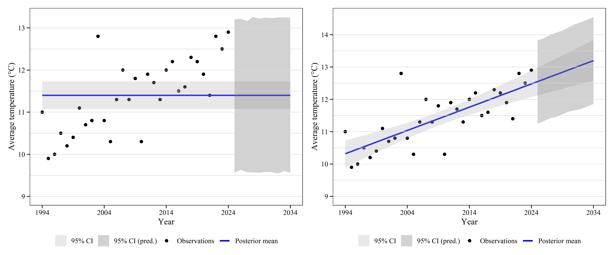
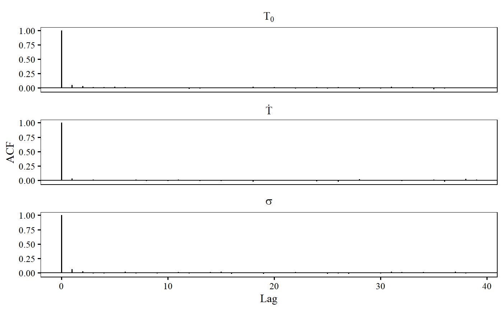
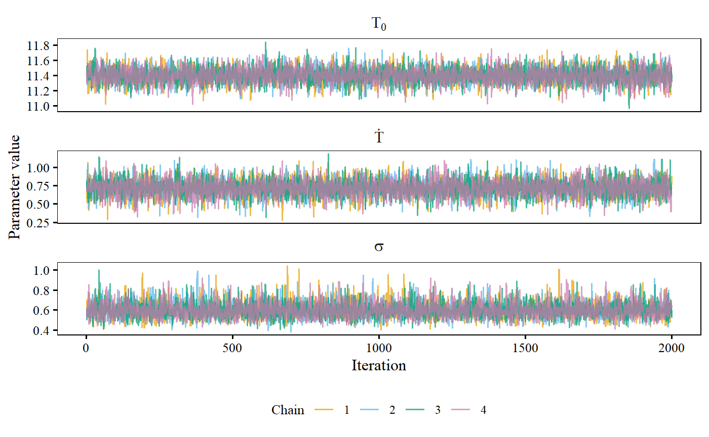
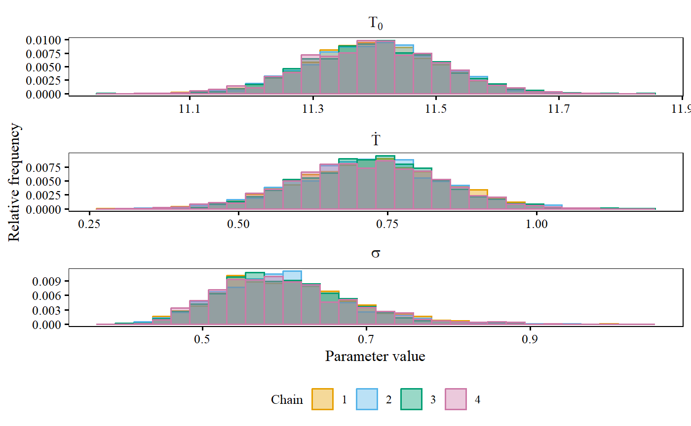
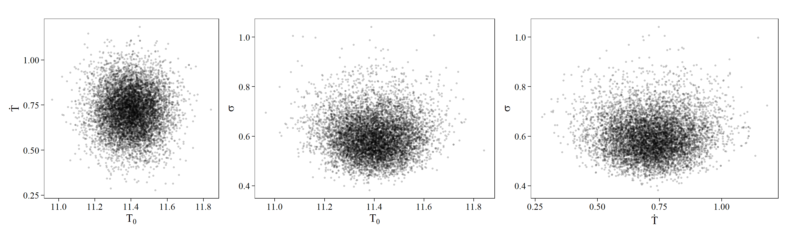

# ARPAV Temperature Trends in the Veneto Region

This repository contains the final project for **Advanced Statistics for Physics Analysis**, taught by **Prof. Jacopo Pegoraro** at the **University of Padova** during the **2025–26 academic year**.

The project investigates long-term temperature trends in ARPAV meteorological records of Veneto region (North Eastern Italy). It is an educational case study, not a comprehensive assessment of climate trends across this region.

## Developers
* Kevin Brugnera (main contributions: Bayesian analysis and prediction, code structuring)
* Marco Lorenzato (main contributions: data preprocessing, plotting)
* Libero Pollini (main contributions: Stan Models, Bayesian analysis and prediction)

## Project Overview

Annual mean temperatures at three selected stations, Monte Summano, Oderzo, and Cittadella, are analyzed with two Bayesian models: a constant-temperature model and a linear-trend model. The report estimates model parameters and uncertainty with R library `Stan`, checks Monte Carlo Markov Chains (MCMC) diagnostics, compares models using Bayes factors and leave-one-out cross-validation (LOO-CV), and produces ten-year posterior predictive forecasts.

## Example Plots
The following are generated plots, all relative to Monte Summano station and (aside from the first one) to the linear model.

**Annual mean temperatures and fitted models.** Observations, posterior mean fits, and 95% credible and predictive intervals for the constant and linear models.



**Autocorrelation diagnostics.** Autocorrelation functions for the sampled model parameters.



**MCMC trace plots.** Parameter values across iterations, shown by sampling chain.



**Posterior parameter distributions.** Marginal distributions for each parameter, shown by sampling chain.



**Parameter correlations.** Pairwise posterior samples showing relationships between model parameters.



## Approach and Findings

We refer to the report (`Report.pdf`) for all details regarding dataset, methodology, and results, and for detailed plots.


Monthly station records are read from the [publicly available ARPAV data files](https://www.arpa.veneto.it/dati-ambientali/open-data/clima/principali-variabili-meteorologiche) and used for exploratory plots. The modeling analysis uses annual mean temperature, with time standardized before fitting the constant and linear models. Posterior estimates, credible intervals, and diagnostic plots are examined. The two models are compared using both Bayes factors and LOO-CV, and their forecasts are shown separately.

The model-comparison results are consistent across criteria. Bayes factors favor the linear model. LOO-CV favors the linear model for Monte Summano and Cittadella, while only slightly favoring the linear model for Oderzo. Thus, the report does establish a uniform trend across the three stations; however results should be interpreted station by station. Forecasts are conditional on the chosen model and its assumptions.


## Repository Structure

```text
.
├── README.md
├── Project.Rmd                 # R Notebook (entry point)
├── Report.pdf                  # FULL DETAILED PROJECT REPORT
├── Project_Description.pdf     # Starting point (assignment) of project
├── functions.R                 # Data handling, plotting, and analysis helpers
├── Stan/                       # Stan models
│   ├── constant_model.stan
│   ├── linear_model.stan
|   ├── constant_model.exe      # Compiled model executable
│   └── linear_model.exe        # Compiled model executable
├── plots/                      # Model fits and Bayesian sampling diagnostics
│   ├── fits_ms.png
│   ├── acfs_ms_lin.png
│   ├── trace_ms_lin.png
│   ├── marginal_distribution_parameters_ms_lin.png
│   └── parameter_correlation_ms_lin.png
└── data/                       # Original ARPAV CSV files
    ├── Cittadella.csv
    ├── Monte_Summano.csv
    └── Oderzo.csv
```

## Limitations and Reproducibility

- This is an educational project with three selected stations, not a representative regional sample. The station selection is not justified by a specific sampling or scientific rationale.
- The analysis compares only constant and linear time trends. Its conclusions depend on the model forms, priors, and selected comparison criteria; prior sensitivity is not explored systematically.
- Reproducing the report requires a compatible R setup, the packages used by the scripts, and `CmdStan`. Local paths, generated files, and compiled Stan executables may need adjustment for another machine, so reproducibility is limited without environment setup and validation.

## Further Work

Potential next steps, also raised in the course feedback, include:

- Try alternative, well-justified priors and assess how posterior estimates and model comparisons change.
- Include all suitable stations in an ensemble or hierarchical model, accounting for station-level differences and shared regional patterns.
- Establish a principled station-selection strategy if a full-station analysis is not feasible; there is no particular reason to privilege the three stations currently analyzed.

## Acknowledgements
The project general structure follows Prof. Pegoraro's instructions. Data used is publicly available from the aforementioned ARPAV website, under 'Creative Commons 4.0 Attribution' License. 

## Declaration of AI Use

Generative Artificial Intelligence (AI) assistance was used for coding assistance, plotting support, and debugging help during the development of this work. They were also used to draft this README. All code was checked and tested by the authors.